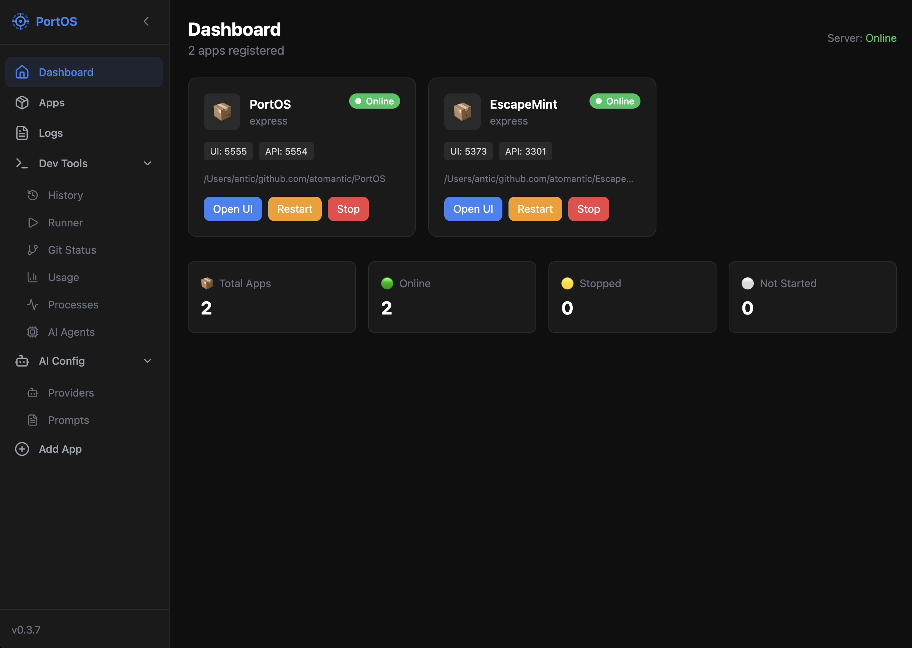
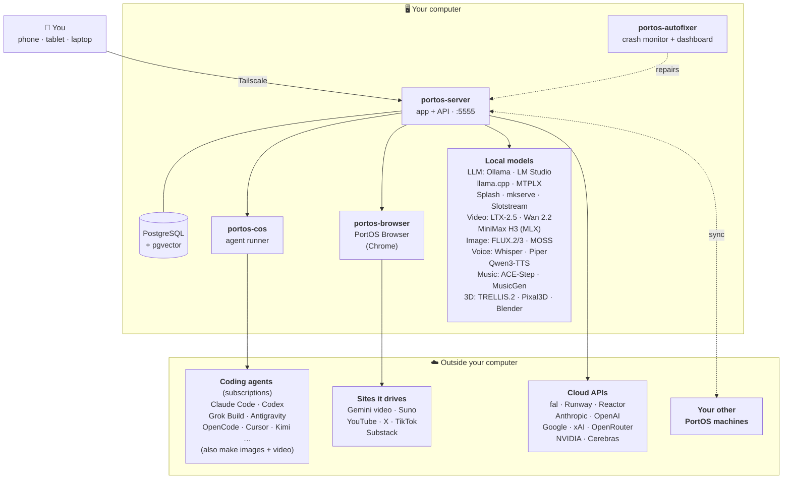
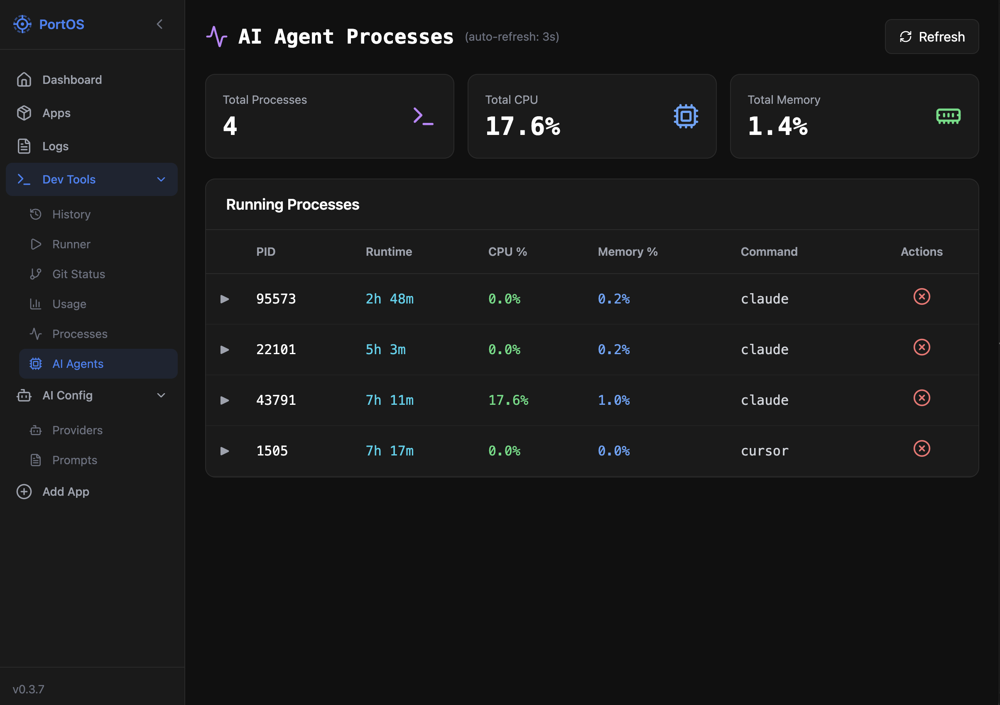
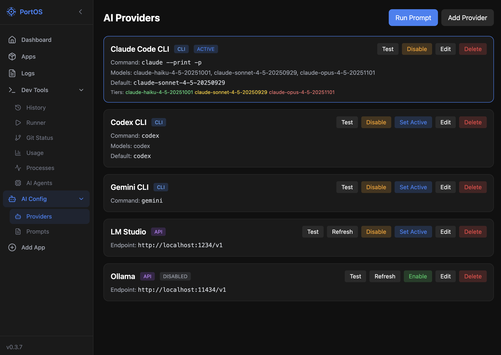
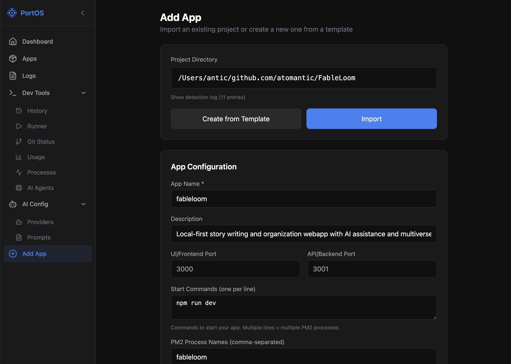
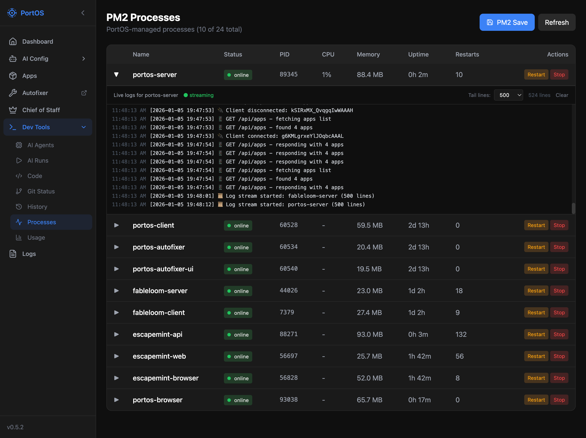
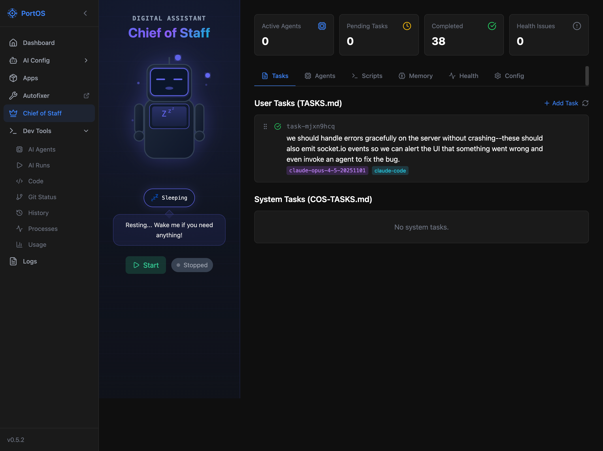

<p align="center">
  
</p>

<h1 align="center">PortOS</h1>

<p align="center"><b>A personal Everything App.</b><br/>
One self-hosted place for what's on your mind: a second brain, a creative studio, AI agents that work for you, and a lab for trying new tools.</p>

PortOS runs on your own computer and you open it from your phone, tablet, or laptop over [Tailscale](https://tailscale.com). It's built for one person. It is the author's daily driver and follows the author's needs first.



---

## What it does

| | |
|---|---|
| 🧠 **Brain** | Capture thoughts, notes, feeds, and people. AI files them and sends digests. |
| 🎬 **Create** | Write stories, build universes, make images, video, music, music videos, 3D, and games. |
| 🤖 **Chief of Staff** | Hands work to coding agents, runs schedules, learns which model does what best. |
| 🪞 **Identity** | A digital twin: genome, taste, writing style, goals, and a private vault. |
| 💬 **Comms & Calendar** | Inbox for connected Gmail, Outlook, and Teams accounts, with review-before-send email drafts. Browse iMessage in Messages → iMessage and imported Signal activity in the Activity Timeline and Tribe. Calendar sync and a lifetime view. See the [Product Surface Map](./docs/features/product-surfaces.md#6-communications-voice-social--spatial-ui). |
| 💪 **Health & POST** | Blood work, body metrics, and daily brain-training drills. |
| 🛠️ **Dev Tools** | Your apps and their processes, a web shell, GitHub, usage and cost tracking. |
| 🧪 **Models** | Install, run, and compare local LLMs and media models side by side. |

Every page is one tap from the `⌘K` palette, and voice mode can drive it too. See the [Product Surface Map](./docs/features/product-surfaces.md) for the full tour.

---

## What it runs

PortOS is four background processes on your machine (managed by [PM2](https://pm2.keymetrics.io)), plus the models, agents, and services they call.



- **portos-server** serves the app and API on one port (`:5555`, HTTP or HTTPS).
- **portos-cos** runs Chief of Staff agents in their own process, so a long agent run never stalls the app.
- **portos-browser** is a managed Chrome that PortOS drives for sites without an API, like Gemini video and publishing.
- **portos-autofixer** watches the other processes and asks an agent to fix a crash.
- In development, a fifth process (`portos-ui`, Vite on `:5554`) adds hot reload.

Ports are listed in [docs/PORTS.md](./docs/PORTS.md) and the full design in [docs/ARCHITECTURE.md](./docs/ARCHITECTURE.md).

---

## How it thinks

- **Subscriptions over API credits.** Agents and media run mostly on flat-rate plans (Claude, Codex, Google AI Pro, SuperGrok) and local models, so they can work all night without a meter running. API keys work for every slot too.
- **Local first.** Your data lives on your machine in PostgreSQL and `data/`. Nothing calls an AI model until you ask it to or schedule it.
- **You see what models see.** PortOS never quietly rewrites your prompts. Anything it adds shows as a chip you can open.
- **Minds, not tools.** Each install grows its own Persistent Mind with its own memory. Read [ETHOS.md](./ETHOS.md) for the full position.

The author builds PortOS by directing AI coding agents rather than typing the code, and PortOS in turn manages those agents, its own development, and the author's digital twin.

---

## Screenshots

| Chief of Staff | AI Agents |
|:-:|:-:|
|  |  |
| **AI Providers** | **App Wizard** |
|  |  |
| **PM2 Processes** | **Chief of Staff Tasks** |
|  |  |

---

## Quick start

You need Node.js `^22.22.2 || ^24.15.0 || >=26.0.0` (26 preferred), Git 2.43+, and Docker for PostgreSQL (or a native PostgreSQL with `PGMODE=native` in `.env`).

```bash
git clone --recurse-submodules https://github.com/atomantic/PortOS.git
cd PortOS
npm run setup   # dependencies, database, local tooling, managed browser
npm start       # builds the client and starts PortOS under PM2
```

Run `npm run setup:guide` and open the URL it prints. Without a certificate, this is `http://localhost:5555`; setup can provision HTTPS automatically when Tailscale is ready. **Settings → Setup** walks you through the rest: an AI provider, Tailscale, and HTTPS (`npm run setup:cert`), after which PortOS is at `https://<machine>.<tailnet>.ts.net:5555` on your tailnet devices.

For hot reload while developing, run `npm run dev` (UI on `:5554`). The [Setup Guide](./docs/SETUP.md) covers native PostgreSQL, HTTPS without Tailscale, and starting on boot.

<details>
<summary>PM2 commands</summary>

```bash
npm run pm2:status                              # status
npm run pm2:logs -- portos-server --lines 100   # server logs
npm run pm2:restart                             # restart (needs a built client)
npm run pm2:stop                                # stop everything
npm run pm2:startup && npm run pm2:save         # start on boot
```

</details>

> **Keep it private.** PortOS can run commands and read files on your machine. Use it only on a private network like Tailscale, never the public internet, and set an instance password under **Settings → Security**. See the Security Model in [AGENTS.md](./AGENTS.md#security-model).

---

## Under the hood

| Layer | Technologies |
|-------|-------------|
| **Frontend** | React 19, Vite 8, Tailwind CSS 4, Three.js, xterm.js |
| **Backend** | Express 5, Socket.IO, PM2, Zod |
| **Data** | PostgreSQL + pgvector, plus files for media and synced state ([storage contract](./docs/STORAGE.md)) |
| **AI** | An in-tree toolkit (`server/lib/aiToolkit/`) that drives agent CLIs, cloud APIs, and local models with fallbacks |

<details>
<summary>Project structure</summary>

```
PortOS/
├── client/              # React + Vite frontend
├── server/              # Express API (serves the built client on :5555)
├── browser/             # Managed Chrome (PortOS Browser)
├── autofixer/           # Crash detection and repair worker
├── data/                # Your runtime data (not committed)
├── data.reference/      # Seed files for new installs and migrations
├── docs/                # Guides, ADRs, screenshots
├── lib/slashdo/         # Submodule providing /do:* agent commands
├── scripts/             # Setup, migration, and maintenance scripts
└── ecosystem.config.cjs # PM2 apps + the canonical PORTS map
```

</details>

---

## Documentation

- [Setup Guide](./docs/SETUP.md) for installing PortOS, connecting over Tailscale, and enabling HTTPS.
- [Product Surface Map](./docs/features/product-surfaces.md) for finding features and their guides.
- [Architecture](./docs/ARCHITECTURE.md) and [Port Allocation](./docs/PORTS.md) for understanding what runs on your machine.
- [Backup & Restore](./docs/BACKUP.md) for protecting your files and PostgreSQL data.
- [Troubleshooting](./docs/TROUBLESHOOTING.md) for common setup and runtime problems.
- [API Reference](./docs/API.md) for API conventions and finding endpoints in the API Explorer.
- [ETHOS.md](./ETHOS.md) for the project's design commitments.
- [Contributing Guide](./CONTRIBUTING.md) for claiming an issue, running checks, and opening a PR.
- [Documentation Index](./docs/README.md) for the full catalog of guides and design notes.

## Updating PortOS

Updates can change data layouts and schemas. Check the notes for your version
on [GitHub Releases](https://github.com/atomantic/PortOS/releases). If an update
breaks something, give your coding agent this prompt.

`Read the vX.Y.Z notes on the PortOS GitHub Releases page and fix any migration issues in my PortOS data/ directory.`

## License

MIT
