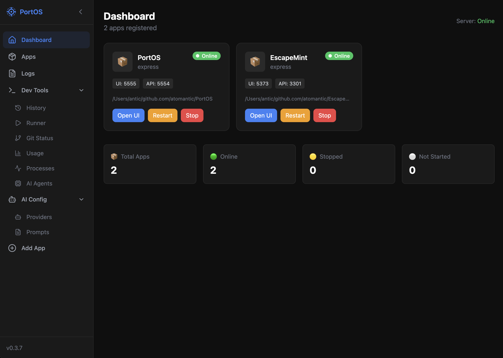
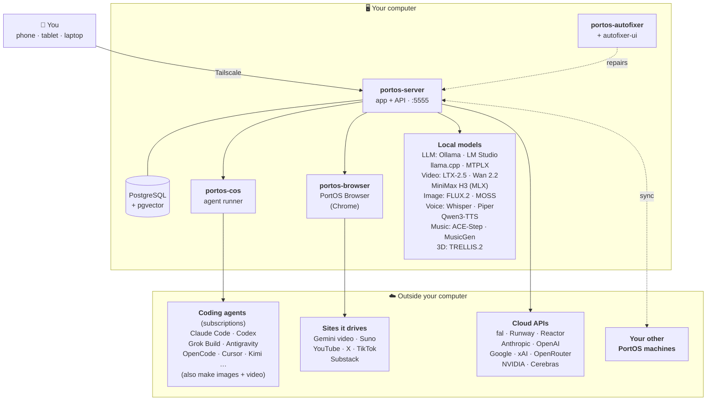
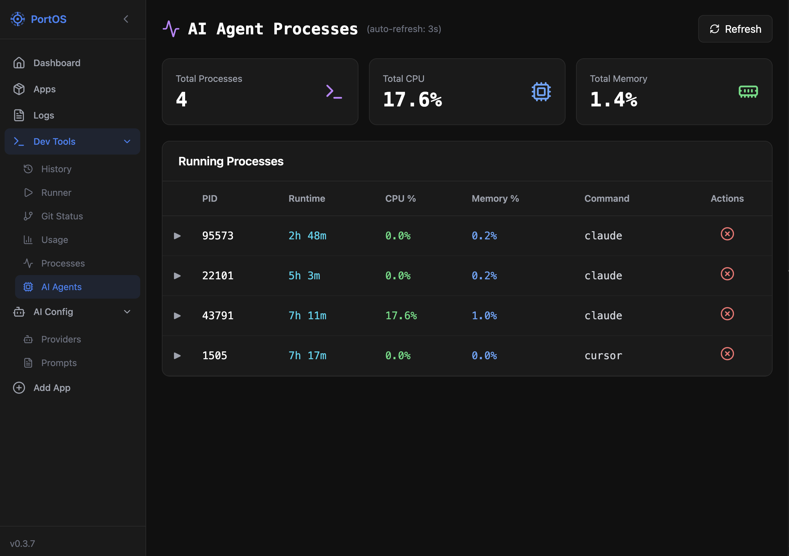
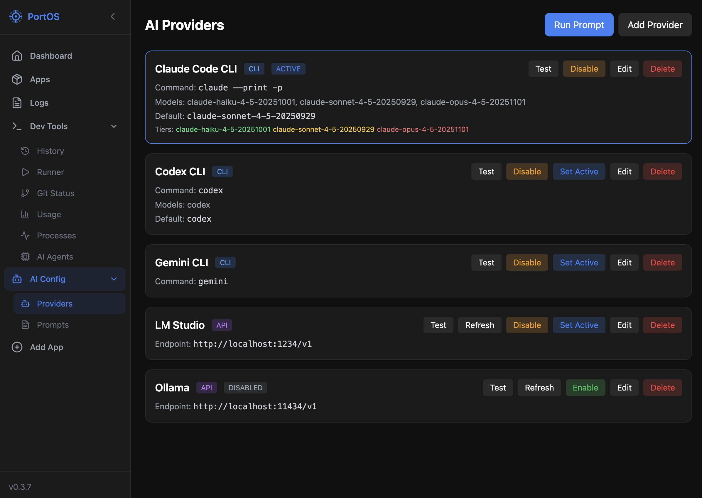
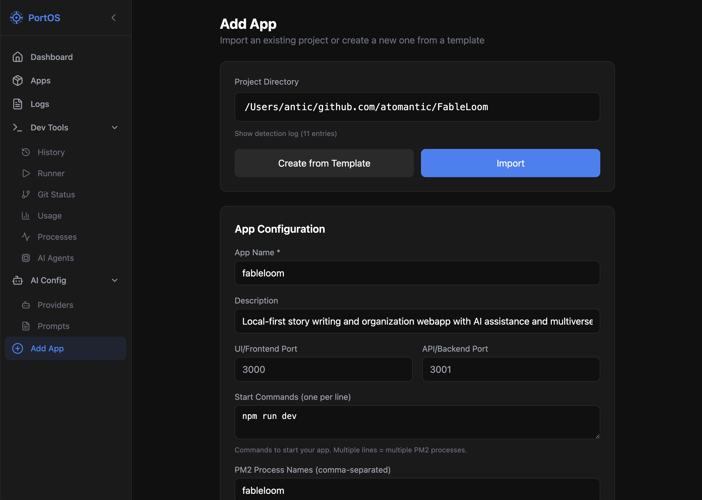
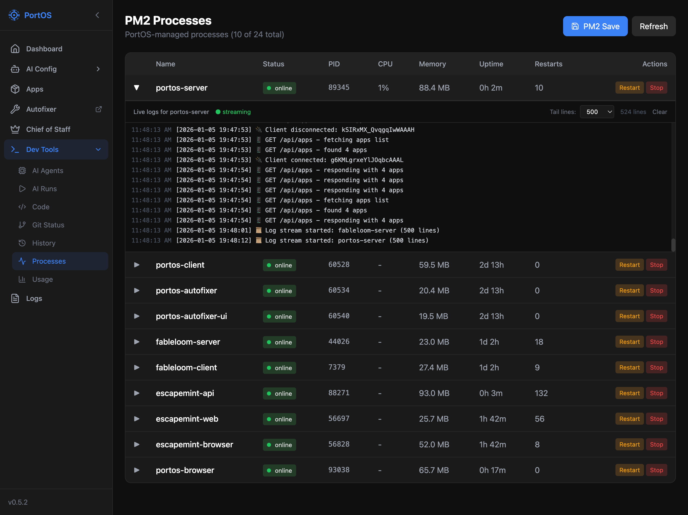
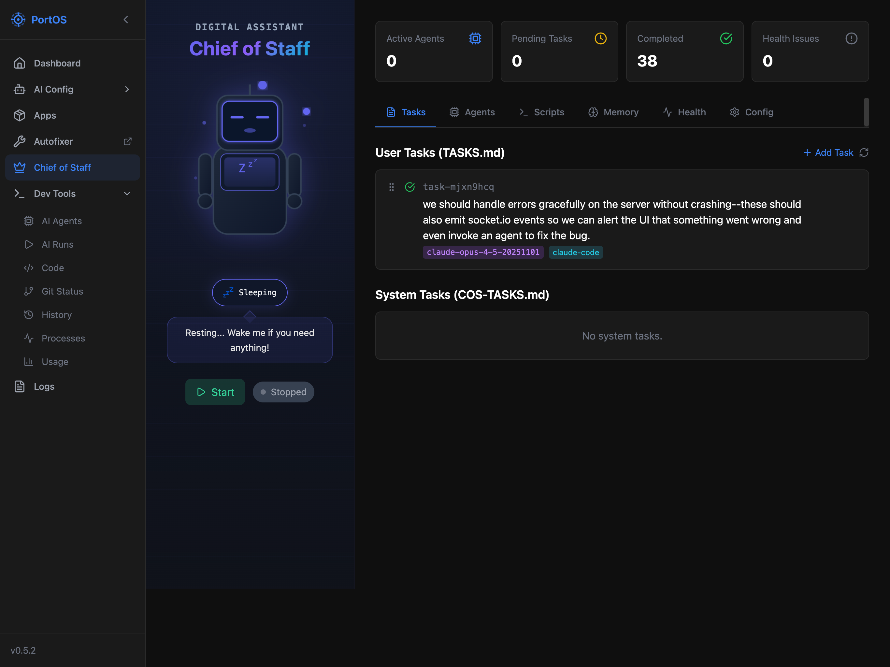

<p align="center">
  
</p>

<h1 align="center">PortOS</h1>

<p align="center"><b>A personal Everything App.</b><br/>
One self-hosted place for what's on your mind: a second brain, a creative studio, AI agents that work for you, and a lab for trying new tools.</p>

PortOS runs on your own computer and you open it from your phone, tablet, or laptop over [Tailscale](https://tailscale.com). It's built for one person. It is the author's daily driver and follows the author's needs first.



---

## What it does

| | |
|---|---|
| 🧠 **Brain** | Capture thoughts, notes, feeds, and people. AI files them and sends digests. |
| 🎬 **Create** | Write stories, build universes, make images, video, music, music videos, 3D, and games. |
| 🤖 **Chief of Staff** | Hands work to coding agents, runs schedules, learns which model does what best. |
| 🪞 **Identity** | A digital twin: genome, taste, writing style, goals, and a private vault. |
| 💬 **Comms & Calendar** | One inbox for your messages, with drafts, plus calendar sync and a lifetime view. |
| 💪 **Health & POST** | Blood work, body metrics, and daily brain-training drills. |
| 🛠️ **Dev Tools** | Your apps and their processes, a web shell, GitHub, usage and cost tracking. |
| 🧪 **Models** | Install, run, and compare local LLMs and media models side by side. |

Every page is one tap from the `⌘K` palette, and voice mode can drive it too. See the [Product Surface Map](./docs/features/product-surfaces.md) for the full tour.

---

## What it runs

PortOS is five background processes on your machine (managed by [PM2](https://pm2.keymetrics.io)), plus the models, agents, and services they call.



- **portos-server** serves the app and API on one port (`:5555`, HTTP or HTTPS).
- **portos-cos** runs Chief of Staff agents in their own process, so a long agent run never stalls the app.
- **portos-browser** is a managed Chrome that PortOS drives for sites without an API, like Gemini video and publishing.
- **portos-autofixer** watches the other processes and asks an agent to fix a crash.
- In development, a sixth process (`portos-ui`, Vite on `:5554`) adds hot reload.

Ports are listed in [docs/PORTS.md](./docs/PORTS.md) and the full design in [docs/ARCHITECTURE.md](./docs/ARCHITECTURE.md).

---

## How it thinks

- **Subscriptions over API credits.** Agents and media run mostly on flat-rate plans (Claude, Codex, Google AI Pro, SuperGrok) and local models, so they can work all night without a meter running. API keys work for every slot too.
- **Local first.** Your data lives on your machine in PostgreSQL and `data/`. Nothing calls an AI model until you ask it to or schedule it.
- **You see what models see.** PortOS never quietly rewrites your prompts. Anything it adds shows as a chip you can open.
- **Minds, not tools.** Each install grows its own Persistent Mind with its own memory. Read [ETHOS.md](./ETHOS.md) for the full position.

The author builds PortOS by directing AI coding agents rather than typing the code, and PortOS in turn manages those agents, its own development, and the author's digital twin.

> **Opinionated and personal.** PortOS assumes one person, one private network, and the author's workflow. Pull requests are welcome, but updates can break things. If one does, ask your coding agent: `"Read .changelog/vX.Y.Z.md and fix any migration issues in my PortOS data/ directory."`

---

## Screenshots

| Chief of Staff | AI Agents |
|:-:|:-:|
|  |  |
| **AI Providers** | **App Wizard** |
|  |  |
| **PM2 Processes** | **Chief of Staff Tasks** |
|  |  |

---

## Quick start

You need Node.js `^22.22.2 || ^24.15.0 || >=26.0.0` (26 preferred), Git 2.43+, and Docker for PostgreSQL (or a native PostgreSQL with `PGMODE=native` in `.env`).

```bash
git clone --recurse-submodules https://github.com/atomantic/PortOS.git
cd PortOS
npm run setup   # dependencies, database, local tooling, managed browser
npm start       # builds the client and starts PortOS under PM2
```

Open `http://localhost:5555`. **Settings → Setup** walks you through the rest: an AI provider, Tailscale, and HTTPS (`npm run setup:cert`), after which PortOS is at `https://<machine>.<tailnet>.ts.net:5555` on every device.

For hot reload while developing, run `npm run dev` (UI on `:5554`). The [Setup Guide](./docs/SETUP.md) covers requirements, npm versions, native PostgreSQL, HTTPS without Tailscale, and starting on boot.

<details>
<summary>PM2 commands</summary>

```bash
npm run pm2:status                              # status
npm run pm2:logs -- portos-server --lines 100   # server logs
npm run pm2:restart                             # restart (needs a built client)
npm run pm2:stop                                # stop everything
npm run pm2:startup && npm run pm2:save         # start on boot
```

</details>

> **Keep it private.** PortOS can run commands and read files on your machine. Use it only on a private network like Tailscale, never the public internet, and set an instance password under **Settings → Security**. See the Security Model in [AGENTS.md](./AGENTS.md#security-model).

---

## Under the hood

| Layer | Technologies |
|-------|-------------|
| **Frontend** | React 19, Vite 8, Tailwind CSS 4, Three.js, xterm.js |
| **Backend** | Express 5, Socket.IO, PM2, Zod |
| **Data** | PostgreSQL + pgvector, plus files for media and synced state ([storage contract](./docs/STORAGE.md)) |
| **AI** | An in-tree toolkit (`server/lib/aiToolkit/`) that drives agent CLIs, cloud APIs, and local models with fallbacks |

<details>
<summary>Project structure</summary>

```
PortOS/
├── client/              # React + Vite frontend
├── server/              # Express API (serves the built client on :5555)
├── browser/             # Managed Chrome (PortOS Browser)
├── autofixer/           # Crash detection and repair worker
├── data/                # Your runtime data (not committed)
├── data.reference/      # Seed files for new installs and migrations
├── docs/                # Guides, ADRs, design plans, screenshots
├── lib/slashdo/         # Submodule providing /do:* agent commands
├── scripts/             # Setup, migration, and maintenance scripts
└── ecosystem.config.cjs # PM2 apps + the canonical PORTS map
```

</details>

---

## Documentation

Full catalog (including design plans, ADRs, and research notes): [docs/README.md](./docs/README.md)

### Architecture & Operations
- [Architecture Overview](./docs/ARCHITECTURE.md) — System design, data flow, and service diagram
- [API Reference](./docs/API.md) — REST endpoints, full route-domain index, and WebSocket events
- [API Tool Contract](./docs/API_TOOL_CONTRACT.md) — Unified semantic tool, Persistent Mind, and Agent Tools MCP contract
- [Companion App API](./docs/COMPANION_APP_API.md) — PortDeck native mobile client discovery and HTTP API contract
- [Setup Guide](./docs/SETUP.md) — Tailscale, MagicDNS, trusted HTTPS, launch URLs, and AI-provider readiness
- [Remote Desktop Broker](./docs/REMOTE_DESKTOP.md) — PortDeck VNC broker security, host setup, and session flow
- [Federated Media Providers](./docs/FEDERATED_MEDIA_PROVIDERS.md) — Authenticated, capacity-aware peer audio provider wire contract and setup
- [Storage Classification Contract](./docs/STORAGE.md) — when data belongs in PostgreSQL vs the filesystem, plus the new-data-store checklist
- [Backup & Restore](./docs/BACKUP.md) — filesystem snapshots + mandatory PostgreSQL dumps and how to restore them
- [Port Allocation](./docs/PORTS.md) — Port conventions (5553-5569) and allocation guide
- [PM2 Configuration](./docs/PM2.md) — PM2 patterns and best practices
- [Quota Burn Automation](./docs/QUOTA-BURN.md) — Subscription quota spending loop and window rules
- [Three.js Models](./docs/THREEJS_MODELS.md) — Procedural Three.js scene generation and trust boundary
- [Fork-Aware Self-Update](./docs/SELF_UPDATE.md) — Fork-aware self-update flow, release polling, and sync mechanisms
- [Windows Console Focus](./docs/WINDOWS_CONSOLE.md) — Console window focus handling and background spawn mitigation on Windows
- [The `METRICS.md` Convention](./docs/METRICS.md) — How a managed app declares the metrics agents should judge it by

### Development
- [Contributing Guide](./docs/CONTRIBUTING.md) — Development setup and code conventions
- [GitHub Actions](./docs/GITHUB_ACTIONS.md) — CI/CD workflow patterns
- [Versioning & Releases](./docs/VERSIONING.md) — Semantic versioning and release process
- [Dependency Audit](./docs/DEPS.md) — Every third-party dependency and why it stays
- [Troubleshooting](./docs/TROUBLESHOOTING.md) — Common issues and solutions

### Feature Deep Dives

- [Product Surface Map](./docs/features/product-surfaces.md) — Browse every user-facing PortOS surface and its canonical guide
- [Voice Mode](./docs/features/voice.md) — local STT/TTS/LLM voice assistant setup
- [Chief of Staff](./docs/features/chief-of-staff.md) — Autonomous agent orchestrator
- [Operational Goals](./docs/GOALS_OPERATIONAL.md) — Runtime priorities the CoS reads when generating work
- [Agent Tools (MCP)](./docs/features/agent-context.md) — Loopback-only bounded context plus independently granted semantic PortOS tools for local CoS agents
- [Agent Skills](./docs/features/agent-skills.md) — Task-type-specific agent prompts
- [Claude on Ollama](./docs/features/claude-ollama.md) — Run agent tasks on a local model
- [Fleet LLM Host](./docs/features/fleet-llm-host.md) — Dedicated GPU host serving OpenAI-compatible models to a PortOS fleet
- [CoS Agent Runner](./docs/features/cos-agent-runner.md) — Isolated agent process architecture
- [CoS Enhancement](./docs/features/cos-enhancement.md) — Hybrid search, proactive execution, error recovery
- [MTPLX](./docs/features/mtplx.md) — Native multi-token-prediction Qwen runtime on Apple Silicon, managed as a PM2 process from Models → Runtimes
- [DFlash 2 / DSpark](./docs/features/dflash2.md) — Speculative drafting acceleration for local llama-server
- [vLLM RTX 3090](./docs/features/qwen38-rtx3090.md) — Docker compose setup for Qwen 27B on NVIDIA RTX 3090 GPUs
- [SGLang Qwen](./docs/features/sglang-qwen38.md) — SGLang engine configuration for Hopper/Blackwell hardware
- [Memory System](./docs/features/memory-system.md) — Semantic memory with vector search and importance decay
- [Digital Twin](./docs/features/digital-twin.md) — Genome, chronotype, taste, and mortality-aware goals
- [Identity System](./docs/features/identity-system.md) — Extended identity modeling (P1-P3)
- [Soul System](./docs/features/soul-system.md) — Identity scaffold with behavioral testing
- [Privacy Center](./docs/features/privacy-center.md) — Machine-local vault, data brokers, and organization change tracking
- [Brain System](./docs/features/brain-system.md) — Offline-first second brain
- [POST](./docs/features/post.md) — Daily cognitive training
- [App Wizard](./docs/features/app-wizard.md) — App registration and scaffolding
- [Autofixer](./docs/features/autofixer.md) — Autonomous crash detection and repair
- [Browser](./docs/features/browser.md) — Headless browser automation
- [Eidoverse Worlds](./docs/features/eidoverse.md) — private 3D systems world and PortOS resource projection
- [OpenWorld historical reference](./docs/features/openworld.md) — retired compatibility surface
- [Prompt Manager](./docs/features/prompt-manager.md) — Customizable AI prompt templates
- [JIRA Sprint Manager](./docs/features/jira-sprint-manager.md) — Autonomous JIRA triage and implementation
- [Writers Room](./docs/features/writers-room.md) — Prose-to-media writing environment with explicit AI passes
- [FableLoom](./docs/features/fableloom.md) — Interactive branching narrative engine and graph reader
- [Sprite Export Contract](./docs/features/sprite-export-contract.md) — What a published sprite atlas guarantees a consuming game
- [Video Text Encoders](./docs/features/video-text-encoders.md) — Dual-encoder memory and clip conditioning for video models
- [Video Speed Profiles](./docs/features/video-speed-profiles.md) — Fast sampling profiles and runtime acceleration for video models
- [Music Renderer Benchmarks](./docs/features/music-renderer-benchmarks.md) — Benchmarking profiles and listening test evidence for local renderers
- [OpenClaw](./docs/features/openclaw-operator-chat.md) — In-app operator-agent chat
- [Stacker News](./docs/features/stacker-news.md) — Territory management and content stewardship
- [Messages Security Model](./docs/features/messages-security.md) — Prompt-injection boundary around untrusted message content
- [Error Handling](./docs/features/error-handling.md) — Centralized error normalization and recovery

## Contributing

Read [CONTRIBUTING.md](./CONTRIBUTING.md) for issue claiming and PR acceptance.
Comment to request an issue and wait for assignment before starting; issues
labeled `in-progress` or already assigned are not up for grabs.

Pull requests are welcome. This is a personal project, so:

- **Breakage happens.** Major version bumps (e.g. v2.0.0) may rename pages, reorganize data directories, or change schemas in ways that require a migration pass on your local data. Check the relevant `.changelog/vX.Y.Z.md` for what changed.
- **Data migration.** If something stops working after an update, the fastest fix is to point your coding agent at the changelog: `"Read .changelog/vX.Y.Z.md and fix any migration issues in my PortOS data/ directory."` Most data issues are trivially auto-fixable this way.
- **Opinionated by design.** Architecture decisions (single-user, auth optional and off by default, PostgreSQL + flat files over a heavy ORM, Tailscale-only networking) are intentional and will not change. PRs that add multi-user support or general-purpose hardening — CORS restrictions, rate limiting, request-level concurrency controls — will not be merged. See the Security Model section of [AGENTS.md](./AGENTS.md) for what that trust model does and does not assume.
- **Style.** Match the existing conventions in [AGENTS.md](./AGENTS.md) before opening a PR — especially the no-try/catch route convention, emoji-prefixed logging, and Zod validation on all inputs.

## License

MIT
