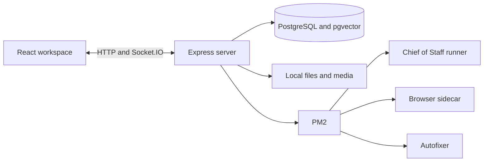

# Architecture Overview

PortOS pairs a React workspace with an Express server and host-local services.
PM2 manages the application processes. PostgreSQL with pgvector is the required
primary datastore. See [product surfaces](features/product-surfaces.md) for
where features appear in the workspace.

## System Diagram

## Directory Structure

| Directory | Responsibility |
| --- | --- |
| `client/src/` | Pages, navigation, components, hooks and domain API clients |
| `server/routes/` | HTTP entry points and request validation |
| `server/services/` | Domain behavior, persistence and integrations |
| `server/lib/` | Shared modules, contracts and DB schemas |
| `browser/`, `autofixer/` | Browser automation and crash-repair sidecars |
| `scripts/`, `data.reference/` | Setup, migrations and shipped defaults |

## Data Flow

React calls domain API clients in `client/src/services/`. Express routes validate
inputs with Zod and delegate to services. Those services read and write
PostgreSQL or local files, or call host integrations such as PM2. Route errors
flow through the centralized handler. See the [API guide](API.md) and
[storage policy](STORAGE.md) for the request and persistence contracts.

The server pushes status, progress and data changes through Socket.IO.
Clients apply their own mutation responses immediately and reconcile any missed
events on reconnect. Long-running jobs may also stream updates over SSE. See
[realtime updates](UX_DESIGN_GUIDE.md#realtime-updates-not-polling).

### Chief of Staff

[Chief of Staff](features/chief-of-staff.md) evaluates queued and scheduled work,
selects the configured provider and model, and dispatches agents through the
runner. Progress and outcomes are recorded by the server and surfaced in the
workspace. [AI providers](AI_PROVIDERS.md) describes the available integrations.

### Peer Sync

Installations can share enabled categories with paired peers on the user's own
network. Periodic snapshot pulls reconcile state, while live media events reduce
latency. Committed deletion tombstones travel with sync so an offline replica
can retire its stale copy when it reconnects. See the
[federation decision](decisions/2026-09-19-user-controlled-federation.md) and
[peer administration](features/peer-administration.md).

### Browser Automation and Autofixer

The [browser sidecar](features/browser.md) runs persistent Chromium. The server
proxies browser management and authorized agents use CDP for automation. The
[autofixer](features/autofixer.md) monitors PM2 crashes, asks a restricted CLI
provider to propose repairs in a disposable checkout, and stages or promotes
patches under the configured verification and promotion policy.

## Security Model

PortOS is a single-operator system on a private Tailscale network. Host control
runs with host privileges. Keep its UI, APIs, sockets and sidecars private.
Instance password authentication and HTTPS are opt-in. Sensitive operations need
operator authority, including when requested by a reachable peer. Use the
[repository security model](../AGENTS.md#security-model) and
[containment profiles](CONTAINMENT.md) when changing these boundaries.

## PM2 Process Map

| Process | Port | Purpose |
| --- | --- | --- |
| `portos-server` | 5555 | Express API and production UI |
| `portos-ui` | 5554 | Vite in development |
| `portos-browser` | 5556, 5557 | Chromium CDP and health |
| `portos-cos` | 5558 | Chief of Staff runner |
| `portos-autofixer` | 5560 | Crash monitoring and repair UI |

PostgreSQL runs outside PM2 as a system service or container. See
[port allocation](PORTS.md) and the [PM2 guide](PM2.md) for configuration.

## Extension Points

### Adding a New Page

Add the page and its route in `client/src/App.jsx`. Add the command to
`NAV_COMMANDS` in `server/lib/navManifest.js` for palette and voice discovery,
and the icon to `NAV_PRESENTATION`. Register and tag optional features through
the [instance feature registry](INSTANCE_FEATURES.md). Follow the
[workspace design guide](UX_DESIGN_GUIDE.md).

### Adding an API Endpoint

Mount the route in `server/index.js`. Use reusable Zod schemas with
`validateRequest` and send errors through the centralized handler. Register
operation metadata and errors in `server/lib/apiOperationContracts.js`, adding
`x-portos-tool` if the operation is agent-callable. Declare emitted events in
`server/lib/socketEventContracts.js`. See the
[API tool contract](API_TOOL_CONTRACT.md).

### Adding a Service or Shared Helper

Keep domain work in `server/services/`, pure helpers in the appropriate
`lib/` directory and React lifecycle behavior in `client/src/hooks/`.
Search `node scripts/lib-catalog.js <term>` before adding helpers. Cataloged
modules open with a one-sentence summary of at most 200 characters. Follow the
[module guide](../.claude/skills/portos-add-module/SKILL.md) for placement.

### Adding a Data Store

Choose the tier from the [storage policy](STORAGE.md). Core relational records
belong in PostgreSQL with schema migrations. File-backed collections use
`createCollectionStore` for schema-versioned layouts, atomic writes and queues.

### Adding CoS Task Types

Register a scheduled task and its default interval in
`server/lib/scheduledTaskTypes.js` and `server/services/taskScheduleRegistry.js`.
Add its default prompt and run `node scripts/regen-prompt-integrity-snapshot.js`
after changing prompt defaults. Register configurable audits in
`server/lib/auditCatalog.js`. For a filing-only task, add a preset in
`server/lib/workTracker.js` and use `{trackerInstructions}` in its prompt.
Add its workflow stage in `server/services/workflow.js`. See the
[Quota Burn guide](QUOTA-BURN.md) for how audit presets feed schedules.
