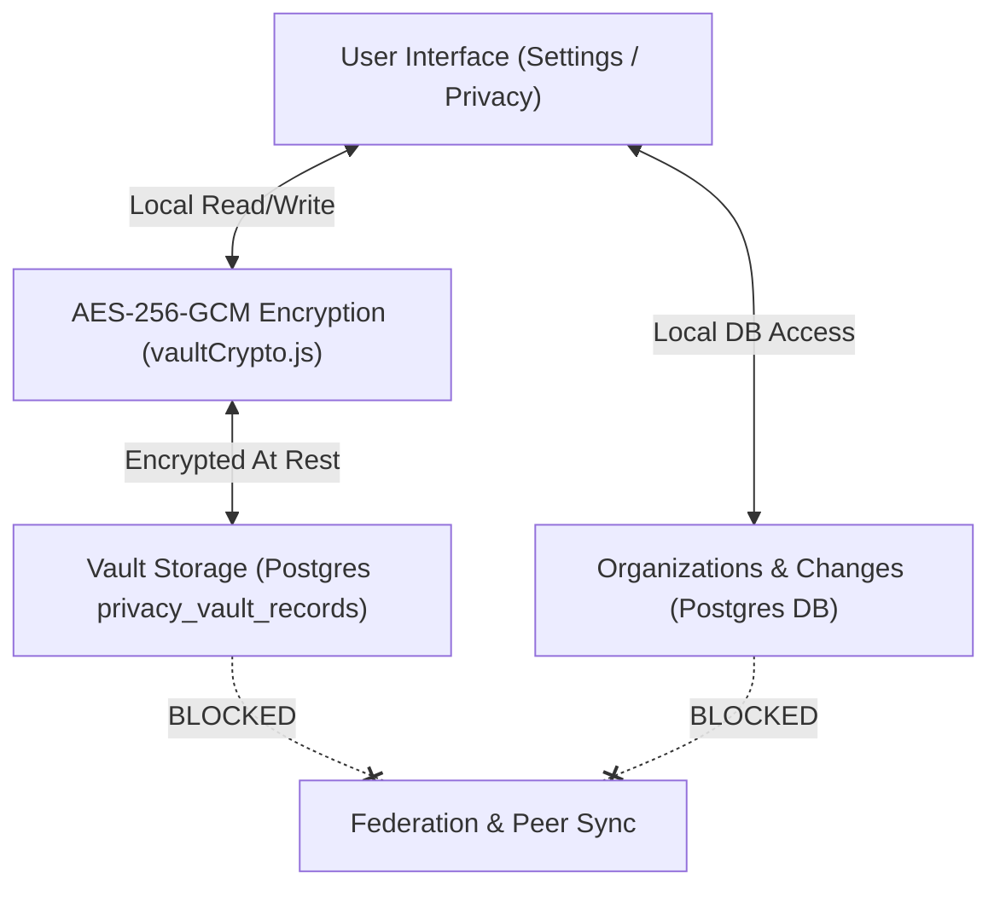

# Privacy Center

The Privacy Center is the PII (Personally Identifiable Information) management subsystem of PortOS. While the Digital Twin models aesthetic tastes, writing style, chronotype, and goals for AI prompts, the Privacy Center handles Sensitive Identity Data and Personal Records that must be protected, machine-local, and explicitly isolated.

> [!IMPORTANT]
> **Privacy Boundary Contract**: Per ADR [privacy records machine-local](../decisions/2026-08-08-privacy-records-machine-local.md), records stored within the Privacy Center are strictly machine-local. They **NEVER** ride the federation layer, sync buckets, or peer-to-peer share networks, and are never included in LLM prompt contexts unless explicitly requested by the user.

---

## Subsystems

### 1. Vault
The **Vault** is an encrypted, machine-local key-value store for sensitive personal documents and numbers:
- Government identification (Passport numbers, SSN / Tax ID, Driver's license)
- Financial identity (Bank account references, tax entity IDs)
- Emergency contacts & private physical addresses

Data in the Vault is stored encrypted at rest (`server/lib/vaultCrypto.js`) using machine-derived key material and requires standard authentication when auth is enabled.

#### Website logins
Website logins (`/api/privacy/logins`, type `website_login`) are origin-bound credentials for the [model-blind browser fill](./browser.md#model-blind-website-login-fill): a username, a password and an optional TOTP setup key (raw Base32 or an `otpauth://totp/...` URI), bound to one or more exact origins such as `https://example.com`. A pasted URL is reduced to its origin; there is no subdomain, suffix or scheme matching.

Manage them in **Privacy Center → Vault → Website logins**. Each saved login shows its label, masked username and exact origins, plus a **2FA Auto** badge when a setup key is saved. Editing never shows the stored username, password or key: leave a field blank to keep it, or tick *Remove the saved 2FA setup key*.

The secrets live only inside the encrypted payload. Listing returns the label, exact origins, a masked username and `hasTotp`, and never decrypts. Website logins are **write-only secrets**: no endpoint returns the password or setup key, the generic reveal refuses the type, and they never join the twin context, broker scans, change declarations or prompt scrubbing. Only the host-side fill decrypts one, right before typing it into a verified tab. 2FA codes are generated on demand by a dependency-free RFC 6238 implementation (`server/lib/totp.js`).

### 2. Organizations
The **Organizations** registry maintains a list of third-party companies, services, and institutions that hold your personal data (e.g. financial institutions, utility providers, subscription services, medical providers). Each entry tracks:
- Account references and data categories held
- Contact channels and privacy policy links
- Data retention & deletion policies

### 3. Changes Inventory
When changing physical addresses, phone numbers, legal names, or primary emails, the **Changes** workflow provides a checklist and tracking matrix:
- Inventory of organizations requiring update
- Notification status per organization (pending, requested, confirmed)
- Verification notes and dates updated

### 4. Data Brokers
The **Data Brokers** module tracks exposure on data brokers, people-search sites, and marketing list aggregators. It manages:
- Opt-out & CCPA / GDPR deletion request tracking
- Direct opt-out URL shortcuts and template letters
- Status verification dates and follow-up reminders

**Consent is per purpose and revocable.** Each household subject holds separate grants (Household drawer), and the scan/opt-out engines refuse — on direct calls and on the automatic recheck schedule alike — without an active grant of the exact purpose:

| Scope | Unlocks | Leaves this machine |
|---|---|---|
| `pii_vault` | Local encrypted vault storage (granted at subject creation) | Nothing |
| `broker_scan` | The read-only exposure scan | Scan-eligible name and city/state, in broker search URLs |
| `broker_optout` | Opt-out submissions and their verification re-probes | Full name, email, phone, city/state (and DOB when a broker requires it) |

A vault grant never implies a broker purpose, and a scan grant never implies submissions. Revoking a broker purpose stamps `revoked_at` on its grant rows — the subject, their vault records, and the audit trail stay — so even the undeletable `self` subject can withdraw it.

---

## Historical Digital Twin cleanup

On older installs, a test response could repeat a shared fact in a scorer prompt, its output, or a saved feedback excerpt. Unsharing, replacing or deleting a Vault fact now scrubs these local copies when the scorer template or feedback type identifies them. Existing backup snapshots and other installations have their own copies.

Operators can also run cleanup without changing a Vault record. The endpoint accepts an operator or delegated agent session through the normal API. This command lists completed Digital Twin runs and saved test-response excerpts.

```sh
node scripts/portos-api.js post /api/privacy/twin-history/cleanup '{"action":"list"}'
```

The inventory returns UUIDs, dates and scorer classifications. For a known self-subject fact, submit `{"action":"scrub","recordId":"<vault-record-uuid>"}` to the same endpoint. This removes exact values from recognized scorer prompts, previews, outputs, diagnostics and test-response snippets. Sensitive Vault types are excluded.

Custom or incomplete scorer templates may appear as `unclassified`. When the original fact is gone or the template is unrecognized, use the date and UUID to identify the intended item. Submit `{"action":"delete","kind":"run","id":"<run-uuid>"}` to delete that completed Digital Twin run, or use `"kind":"feedback"` to erase that excerpt while retaining its rating. Mutations report the number of changed items. After a failure, repeat the operation to finish the remaining changes.

## Purge imported Signal activity by handle

Call `POST /api/signal/blocklist/handles` with one handle or an array of handles. Pass `purgeExisting: true` to erase matching imported activity and any touchpoints and audit snapshots for conversations this leaves empty. Signal Desktop keeps the original messages.

```sh
node scripts/portos-api.js post /api/signal/blocklist/handles '{"handles":["+12025550123"],"purgeExisting":true}'
```

The response includes the saved blocklist, newly `added` handles, and the counts of `purged` activity events and removed `touchpoints`. Repeating the request also checks handles already on the list.

## Security Model & Data Flow



1. **Isolation**: No endpoint under `/api/privacy/*` or `/data/vault*` participates in peer sync or cloud-folder share buckets (`data/sharing/`).
2. **Prompt Injection Safety**: Privacy Center records are omitted from default RAG indices (BM25 & pgvector) used by AI agents and Chief of Staff tasks.
3. **Auditability**: All modifications to Vault entries produce localized JSON audit entries without logging raw payload values.
